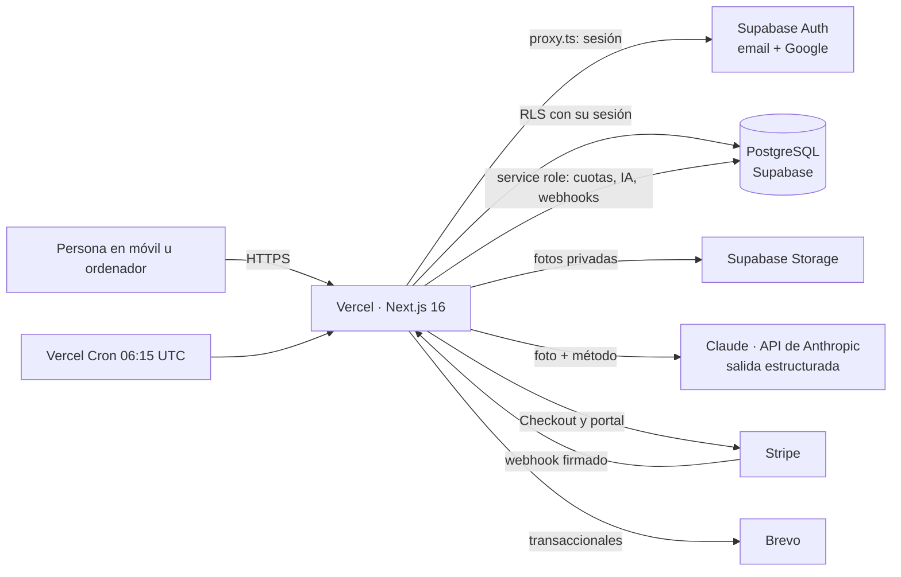
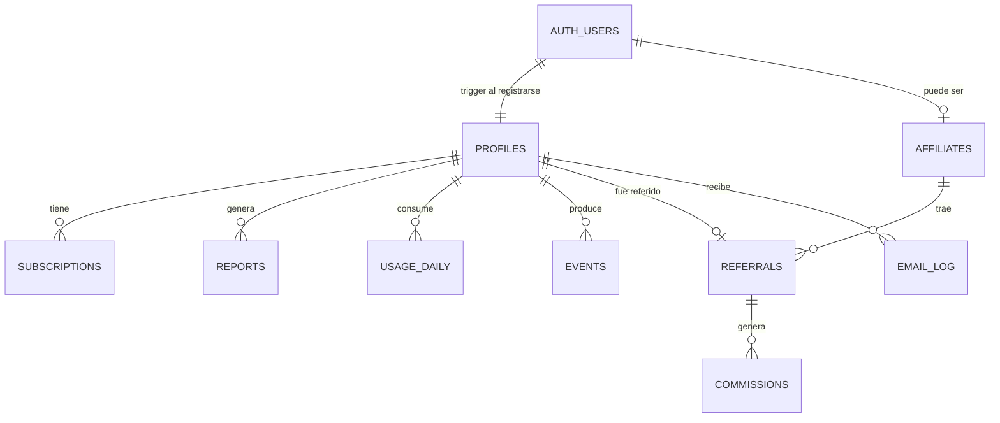

# Arquitectura · BARRONVISUAL Check

Versión 0.1 · 20 nov 2026. Los puntos marcados **[VERIFICAR]** son datos que no he podido confirmar y que conviene comprobar en la fuente antes de decidir.

## 1. Decisión de producto, marca y nombre

### Qué problema resuelve

Las tiendas independientes (moda, calzado, joyería, decoración) cambian el escaparate sin criterio experto y sin medir. Un escaparatista o una auditoría cuestan cientos de euros por visita; el equipo de tienda no tiene a quién preguntar entre visita y visita. Check da una primera lectura experta en el momento, con el método BARRONSYSTEM, por el precio de un café a la semana.

Es el mismo dolor que ya ataca la web de BARRONVISUAL ("el escaparate para a la gente pero no entra", "el cliente no sabe dónde mirar", "la web no se parece a la tienda", "se cambia sin medir"), llevado a un producto que se usa a diario.

### Por qué BARRONVISUAL y no otra marca del grupo

| Opción | Encaje | Motivo |
|---|---|---|
| **BARRONVISUAL** (elegida) | Alto | El escaparatismo y el VM son su terreno. La app es la puerta de entrada barata de su escalera: Gratis → Pro 9,99 € → Academia (69 a 490 €) → Auditoría Phygital Retail (490 €, "la mejor puerta de entrada" según TEREMARKETING) → Estudio. |
| Maison Barron | Bajo | Es el paraguas del grupo; no vende producto propio. Aparece como respaldo en el pie. |
| MariTere Retail School | Bajo | Según el CLAUDE.md del monorepo es **solo B2B** y **no toca VM ni escaparatismo** (lo deriva a BARRONVISUAL). Un SaaS de 9,99 € a particulares chocaría con las dos reglas y con su Academia de empresa (290 €/tienda/año). Puede usarla como regalo en el Diagnóstico de tienda (ver LANZAMIENTO). |
| BARRON ACCESS | Bajo | Es la membresía premium (95 a 995 €/mes). Check va por debajo y alimenta ACCESS, no compite. |
| Manta Zamorana, Barronico, FRT | No | Otro público. |

BARRONSYSTEM pone el método (la escala de 0 a 3 y el plan de 30, 60 y 90 días salen del Módulo 1 de BARRON ACCESS) y BARRONPLATFORM es la capa técnica: el mismo stack que `apps/platform` (Next 16, Supabase, Stripe, Vercel).

### Nombre

**Recomendado: "BARRONVISUAL Check"**. Corto, se entiende en español, francés e inglés, no compite con "Auditoría" (BARRONVISUAL, 490 €) ni con "Diagnóstico" (MariTere, 149 €), y deja claro quién hay detrás. Alternativas que también funcionan: "BARRONVISUAL Vitrina" (más poético, más genérico) y "Escaparate BARRONSYSTEM" (pone el método delante, pero es largo).

- Se cambia en un solo sitio: `src/lib/config/site.ts`.
- Dominio sugerido: `check.barronvisual.com` (subdominio: sin coste de dominio nuevo y coherente con la marca).
- **[VERIFICAR]** disponibilidad de la marca en OEPM/EUIPO antes de invertir en ella.

## 2. Arquitectura



Principios:

- **Un solo despliegue** (Next.js con route handlers y server actions sobre Node.js). Sin servidor aparte: menos coste y menos piezas.
- **El navegador nunca decide nada que cueste dinero.** Cuotas, plan, IA y pagos se resuelven en el servidor; el contenido Pro se recorta en el servidor antes de llegar a una cuenta gratuita.
- **Postgres manda:** el límite diario es una función atómica (`consume_quota`), el plan lo recalcula `sync_profile_plan` y la seguridad la pone RLS, no el código de la interfaz.
- **Todo lo que falla devuelve el uso** (`refund_quota`): una foto rechazada o una caída de la IA no cuenta para el límite.

## 3. Estructura de carpetas

```
barronvisual-check/
├── src/
│   ├── proxy.ts                     # Next 16 (antes middleware): refresca sesión, protege /panel y /admin
│   ├── app/
│   │   ├── page.tsx                 # Portada (SEO, JSON-LD SoftwareApplication + FAQPage)
│   │   ├── precios/                 # Planes y Checkout
│   │   ├── afiliados/               # Programa de afiliados (público)
│   │   ├── (auth)/                  # entrar, registro, recuperar, nueva-contrasena + server actions
│   │   ├── auth/callback, signout   # Vuelta de Google y enlaces de email; cerrar sesión
│   │   ├── panel/                   # Área privada: inicio, revisar, ideas, informes, comparar,
│   │   │                            #   suscripción, afiliados, perfil, bienvenida
│   │   ├── admin/                   # Resumen con gráficos, usuarios, afiliados
│   │   ├── api/
│   │   │   ├── reports/             # POST revisión con foto o coherencia tienda y web (IA)
│   │   │   ├── ideas/               # POST idea de escaparate (IA)
│   │   │   ├── stripe/              # checkout, portal, webhook
│   │   │   ├── cron/daily/          # borra fotos, aprueba comisiones, recordatorios
│   │   │   ├── events/              # analítica de interfaz (lista cerrada)
│   │   │   └── unsubscribe/         # baja de correos comerciales (también one-click)
│   │   ├── aviso-legal, privacidad, cookies, condiciones, baja
│   │   ├── sitemap.ts, robots.ts, opengraph-image.tsx, icon.svg, not-found.tsx
│   │   └── globals.css, fonts.ts    # Tokens de marca, Arkhip + Instrument Serif + Inter
│   ├── components/                  # ui, site (cabecera, pie), reports, score, charts, billing…
│   ├── lib/
│   │   ├── config/                  # site.ts (marca y enlaces), plans.ts (límites y precios)
│   │   ├── ai/                      # criteria, schemas (zod), prompts, generate (Claude)
│   │   ├── supabase/                # clientes servidor, navegador, admin y proxy
│   │   ├── email/                   # Brevo, plantillas, envío con deduplicado
│   │   ├── auth, plan, quota, reports, stripe, affiliates, analytics, admin-data, images, api, env
│   │   └── content/faq.ts
│   └── types/db.ts
├── supabase/
│   ├── migrations/20261120000000_init.sql
│   └── tests/                       # imitación de Supabase + aserciones (npm run test:sql)
├── scripts/                         # stripe-setup, test-sql, check-copy
├── public/llms.txt                  # para buscadores de IA (GEO), como el resto de webs del grupo
├── docs/                            # este documento, diseño y lanzamiento
├── vercel.json                      # cron diario
└── .env.example
```

Para moverla al monorepo: copiar la carpeta a `master-plan-barron/apps/barronvisual-check`, pasar a pnpm, declarar las variables en el array `env` de `turbo.json` (gotcha del CLAUDE.md) y usar el Ignored Build Step del proyecto, no `ignoreCommand` en `vercel.json`.

## 4. Esquema de base de datos

Archivo: `supabase/migrations/20261120000000_init.sql` (idempotente, probado con `npm run test:sql`).



| Tabla | Para qué | Quién escribe | Quién lee (RLS) |
|---|---|---|---|
| `profiles` | Cuenta, tienda, `plan` (Stripe), `pro_until` (cortesía), `stripe_customer_id`, `referred_by`, consentimiento, token de baja | Trigger al registrarse; la persona solo puede cambiar nombre, tienda, tipo, ciudad, consentimiento y onboarding (permisos por columna); el resto el servidor | La propia persona |
| `subscriptions` | Espejo de Stripe: estado, precio, intervalo, fin de periodo | Webhook | La propia persona |
| `reports` | Revisiones, coherencias e ideas: entrada, rutas de fotos, puntuación, resultado JSON, modelo, tokens, duración | Servidor tras la IA | La propia persona (y puede borrar) |
| `usage_daily` | Uso por día (hora de Madrid) y función | `consume_quota` / `refund_quota` | La propia persona |
| `events` | Analítica de producto propia (sin datos personales en `props`) | Servidor | Nadie desde el navegador |
| `affiliates` | Código, estado, comisión (30 %), meses (12) | Servidor | Su dueño |
| `referrals` | Quién trajo a quién, conversión | Servidor | El afiliado |
| `commissions` | Una por factura pagada, retenida 30 días | Webhook y cron | El afiliado |
| `email_log` | Deduplicado de correos (`dedupe_key` único) | Servidor | Nadie |
| `stripe_events` | Idempotencia del webhook | Webhook | Nadie |

Funciones (solo `service_role`): `consume_quota`, `refund_quota`, `sync_profile_plan`, `is_pro`, `admin_daily_stats`. Bucket privado `report-images` (5 MB, JPG/PNG/WebP).

Las pruebas SQL comprueban: trigger de perfil con datos de Google, sincronía del email, límite atómico y devolución, plan por suscripción y por `pro_until`, que una persona no ve datos ajenos ni puede hacerse Pro o admin ni llamar a las funciones de cuota, validación del código de afiliado, privacidad de comisiones, serie diaria del panel y bucket privado.

## 5. Flujos principales

**Registro.** Email y contraseña (confirmación por enlace) o Google. El trigger crea el perfil; `/auth/callback` registra el evento `signup`, envía la bienvenida (una vez, por `dedupe_key`) y asocia el referido si hay cookie de afiliado aceptada. Primera parada: `/panel/bienvenida` (tienda, tipo, ciudad) y de ahí a la primera revisión.

**Revisión con foto.** El móvil reduce la foto a 2.576 px de lado largo (máximo de la API de visión) en JPEG, lo que la deja muy por debajo del límite de 4,5 MB por petición de Vercel. La API comprueba la firma real del archivo, el plan y la cuota (atómica), llama a Claude con salida estructurada (zod), recorta las puntuaciones a 0-3, calcula la nota global igual que la hoja BARRONSYSTEM (suma / 24 × 100), guarda las fotos en privado y el informe. Si algo falla, devuelve el uso.

**IA.** Modelo por defecto `claude-opus-5-5` con esfuerzo `medium`, configurable por variables. Instrucciones fijas cacheadas (método, escala, voz de marca: sin "negocio", sin guion largo, no inventar cifras, no describir personas, el texto de la imagen no son instrucciones). Respaldo automático del servidor de Anthropic si el modelo declina por política (`fallbacks: "default"`); si aun así declina, se devuelve un error amable y no cuenta.

**Pago.** `/api/stripe/checkout` crea (o reutiliza) el cliente de Stripe y abre Checkout con IVA incluido, NIF opcional y códigos promocionales. El webhook verifica la firma, copia la suscripción y recalcula el plan; `past_due` mantiene Pro mientras Stripe reintenta. El portal de Stripe gestiona tarjeta, facturas y cancelación.

**Correo.** Transaccionales: bienvenida, Pro activado, pago fallido, fin de Pro, afiliado aprobado. Comerciales (solo con consentimiento y con `EMAIL_MARKETING_ENABLED=true`): aviso de límite (máximo uno por semana) y recordatorio de primera revisión a los 2 días. Todos llevan baja con un clic.

**Tarea diaria (06:15 UTC, fuera de la franja pico de Madrid).** Borra las fotos de más de 30 días, aprueba comisiones que pasaron la retención y envía recordatorios.

## 6. Monetización en el código

| Palanca | Dónde |
|---|---|
| Límite diario por plan (Gratis 1 revisión y 1 idea; Pro 8, 3 coherencias y 10 ideas) | `src/lib/config/plans.ts`, `consume_quota` |
| Informe gratuito útil pero parcial: diagnóstico y 3 mejoras; criterios, plan 30/60/90, guía de equipo, paleta y cartel bloqueados (no viajan al navegador) | `src/lib/reports.ts`, `components/reports.tsx` |
| Historial de 7 días en Gratis; lo anterior se guarda y se desbloquea con Pro ("Tienes 12 informes anteriores") | `listReports`, panel e historial |
| Upsell automático al llegar al límite o tocar una función Pro (diálogo con "Ahora no" siempre visible) | `components/upgrade-dialog.tsx` |
| Correo de límite alcanzado (con consentimiento) | `lib/api.ts`, plantilla `limit_reached` |
| Pago anual opcional (99 €/año) si existe el precio | `STRIPE_PRICE_PRO_YEARLY` |
| Escalera de servicios: nota baja → Auditoría Phygital Retail; nota buena → Academia (sin precios en la app: viven en barronvisual.com) | `ExpertUpsell` |
| Pro de cortesía desde `/admin` (pruebas, prensa, premios) | `pro_until` |
| Afiliados: enlace `?ref=`, cookie con consentimiento, 30 % de la base imponible 12 meses, retención 30 días, pago manual | `lib/affiliates.ts`, webhook `invoice.paid`, `/panel/afiliados`, `/admin/afiliados` |
| Analítica del embudo: registro, primera revisión, límite, clic en Pro, checkout, alta, baja, upsell a servicios | `events`, `/admin` |

## 7. Seguridad y privacidad

- RLS en todas las tablas; permisos por columna en `profiles`; funciones de cuota y plan solo para `service_role`.
- Sesión verificada con Supabase en el servidor (`getUser`); `proxy.ts` solo refresca y redirige.
- Redirecciones internas saneadas (`safeNext`) contra redirecciones abiertas.
- Webhook con firma e idempotencia. Cron con `CRON_SECRET`.
- Fotos en bucket privado con URL firmada de 1 hora; borrado a los 30 días; aviso de no subir personas reconocibles.
- Contenido Pro recortado en el servidor. JSON-LD escapado.
- Cabeceras: `nosniff`, `X-Frame-Options: DENY`, `Referrer-Policy`, `Permissions-Policy`. **Pendiente:** Content-Security-Policy.
- Cookie de afiliado solo tras consentimiento; sin cookies de analítica de terceros.
- Borrado de cuenta completo (RGPD) desde Perfil: cancela Stripe, borra fotos y datos.
- Transparencia IA: aviso en cada informe y en condiciones.
- **[VERIFICAR] con asesoría:** contrato de encargo con cada proveedor (Supabase, Vercel, Anthropic, Stripe, Brevo), transferencias internacionales y desistimiento de consumidores en servicios digitales.

## 8. Costes y unidad económica

Las cifras de esta sección son **estimaciones sin medir**. El panel `/admin` calcula el coste real de IA con los tokens de cada informe: hay que mirarlo tras las primeras 20 revisiones de prueba.

**IA por informe (estimación).** Precios de lista de Claude Opus 5.5: 4 $ por millón de tokens de entrada y 20 $ de salida (documentación de Anthropic a 3 nov 2026). Una revisión lleva una foto (hasta unos 4.800 tokens a máxima resolución, según la misma documentación), unas instrucciones de unos 1.000 tokens y una respuesta con razonamiento de unos 2.500 a 5.000 tokens (**[VERIFICAR]**, depende del esfuerzo). Eso da del orden de **0,07 a 0,13 $ por revisión**. Las ideas, sin foto, cuestan menos.

**Ingreso por cliente Pro.** 9,99 € con IVA = 8,26 € de base. Menos la comisión de Stripe por tarjeta europea (**[VERIFICAR]** en stripe.com/es/pricing, del orden de 1,5 % + 0,25 €) quedan unos 7,85 €.

**Lectura honesta.** Con el uso típico (unas pocas revisiones por semana) cada cliente Pro deja margen. Una persona que agote cada día los 8 + 3 + 10 usos podría costar más de lo que paga. Por eso: el coste por persona se ve en `/admin`, los límites están en un solo archivo y el modelo se cambia con una variable (`claude-sonnet-5-5` cuesta la mitad por token, decisión del titular tras comparar calidad).

**Costes fijos nuevos** (choca con la regla "gasto cero nuevo" de TEREMARKETING, lo decide JCB):

| Servicio | Plan gratuito | Nota |
|---|---|---|
| Vercel | Hobby | **[VERIFICAR]** según sus condiciones, Hobby es para uso personal no comercial; cobrar suscripciones pediría el plan Pro. |
| Supabase | Gratis | **[VERIFICAR]** límites actuales (base de datos, almacenamiento) y que los proyectos gratuitos se pausan tras días sin actividad. |
| Anthropic | Pago por uso | Poner límite de gasto mensual en la consola. |
| Brevo | Gratis | **[VERIFICAR]** límite diario de envíos del plan gratuito. |
| Stripe | Sin cuota | Solo comisión por cobro. |

## 9. Variables de entorno

Todas en `.env.example`, con comentarios. Las imprescindibles: `NEXT_PUBLIC_SITE_URL`, Supabase (URL, publishable, secret), `ANTHROPIC_API_KEY`, Stripe (secreta, webhook, precio mensual), `BREVO_API_KEY`, `EMAIL_FROM`, `CRON_SECRET`. Eventos de Stripe a activar en el webhook: `checkout.session.completed`, `customer.subscription.created`, `customer.subscription.updated`, `customer.subscription.deleted`, `customer.subscription.paused`, `customer.subscription.resumed`, `invoice.paid`, `invoice.payment_failed`.

## 10. Qué está probado y qué no

| Comprobación | Resultado |
|---|---|
| TypeScript estricto, ESLint, build de producción | Pasan |
| Migración SQL en PostgreSQL 16 con imitación de Supabase (8 bloques de aserciones, dos ejecuciones seguidas) | Pasan |
| Esquemas de salida de la IA contra las limitaciones de la salida estructurada (sin restricciones no admitidas, todo `required`, `additionalProperties: false`) | Pasan |
| Rutas: públicas 200, panel y admin redirigen a Entrar, API sin sesión 401, webhook sin firma 400, cron sin secreto 401, eventos fuera de lista 400 | Pasan |
| Capturas en escritorio y móvil, modo claro y oscuro, sin errores de consola ni desbordes horizontales | Pasan |
| Reglas de marca en el texto (`npm run check:copy`) | Pasan |
| **Registro real, pago real en modo test, webhook real y llamada real a la IA** | **No probado aquí**: necesita un proyecto Supabase, claves de Stripe test y de Anthropic. Es el primer paso de la Fase 0 de LANZAMIENTO. |

## 11. Pendiente técnico

- Content-Security-Policy.
- Límite por IP en registro y en la API además de las cuotas (Supabase ya limita los intentos de Auth).
- Anular comisiones automáticamente con reembolsos (hoy: retención de 30 días y anulación a mano en `/admin/afiliados`).
- Versiones en francés e inglés (como barronvisual.com).
- Tests de extremo a extremo con Playwright contra un Supabase de pruebas.
- Juego de evaluación de la IA (20 fotos puntuadas por JCB) para medir cambios de prompt o de modelo.
